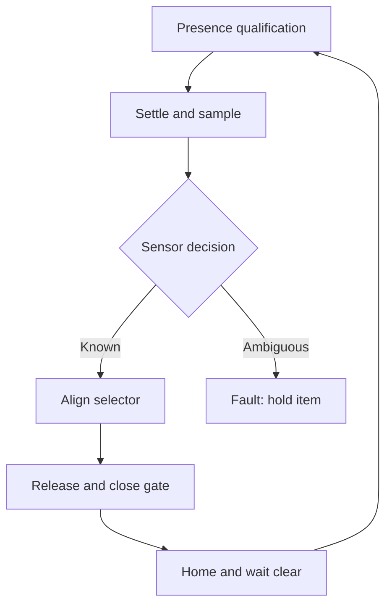

# Architecture and state sequence

The shared controller in `control.h` defines the same sequence used by the sketch. Startup is STOPPED. Arming with clear chamber/closed stop loop commands HOME, waits 700 ms, then requires absence for 300 ms before IDLE. IDLE requires presence for 150 ms; SETTLE waits 200 ms; SAMPLE collects ten readings at >=20 ms intervals.

Classification prioritizes a consistent metal signal, then uses the mean normalized moisture value for non-metal policy cases. Mixed metal votes and the moisture uncertainty band produce UNKNOWN/FAULT. During SETTLE/SAMPLE, loss of presence faults rather than releasing an unclassified item.

Known classification commands the selector angle, waits 700 ms, opens the gate for 600 ms, then commands closed for 400 ms. The command counter increments, the selector returns home for 700 ms, and WAIT_CLEAR requires absence for 300 ms. If WAIT_CLEAR lasts 5 seconds, the cycle faults. There is no independent item-exit sensor: a clear presence detector does not prove the object reached the right bin.

No `delay()` is used in the cycle state machine. Servo pulses are generated by the library. Actual loop/servo timing and mechanical travel need physical measurement. Time comparisons use unsigned subtraction for millis wraparound. A stop/fault commands gate closure while retaining selector position; this is software behaviour, not a certified safety function or position confirmation.

The implementation assumes a single retained item and two actuators. It does not reproduce an unspecified DC motor/conveyor design. No actuator feedback, absolute homing sensor, torque/current measurement, automatic jam clearing, persistent log or network output exists.
