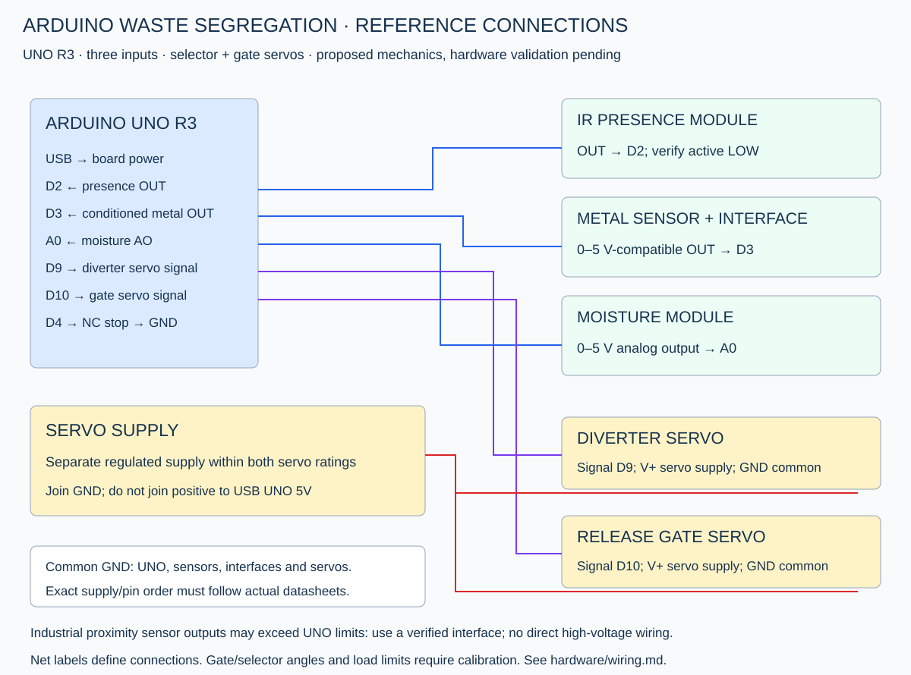

# Proposed reference wiring

Arduino UNO R3, three sensor inputs and two positional servos. These are proposed pins, not confirmed original wiring. The mechanics require a stationary sensing chamber, selector and gate that can hold one item until release.

| Terminal | Connection |
|---|---|
| Presence module OUT | D2, active LOW assumed |
| Presence VCC / GND | Verified module supply / common GND |
| Conditioned metal-sensor OUT | D3, active LOW assumed |
| Metal-sensor power | Datasheet-specified supply; interface required if not UNO-compatible |
| Moisture module AO | A0, strictly within UNO 0–5 V range |
| Moisture VCC / GND | Verified module supply / common GND |
| Diverter servo signal | D9 |
| Release gate servo signal | D10 |
| Both servo V+ | Separate regulated supply within servo rating |
| Both servo GND | Supply negative and common UNO GND |
| Stop loop | D4 through normally closed contact to GND |

## Sensor interfaces

Do not connect a generic 6–36 V proximity sensor output directly to UNO. NPN/PNP, open-collector/push-pull, leakage and internal pull-ups differ. Use an appropriate documented level-conversion/isolation interface so D3 sees 0–5 V only. An open-collector output may use INPUT_PULLUP only if its exact voltage/leakage behaviour is compatible; this is not a universal wiring rule. Confirm the actual metal detector can detect the target materials at the chosen distance.

Presence D2 and metal D3 use INPUT_PULLUP and default LOW detection. Verify polarity in serial logs and change constants to match your modules. Disconnects/shorts can look like legitimate presence/absence. A0 moisture values are relative ADC readings, not moisture percentage; rail values do not automatically establish a fault or valid measurement.

## Servo power and mechanics

USB powers UNO during bench bring-up. Use a separate regulated servo supply sized for both servos' peak/stall current and specified voltage. Join grounds; do not tie its positive rail to UNO's USB-powered 5V pin. Verify decoupling and wiring against actual servo requirements. Do not power loaded servos from the UNO 5V rail.

Calibrate with linkages/horns unloaded first. Reference diverter angles are METAL 30°, WET 90°, DRY 150° and HOME 90°. Gate closed/open are 20°/80°. They are commands, not verified physical stops. Align chute positions and validate travel limits, torque and timing before fitting a load. HOME shares WET's selector angle, but the gate is commanded closed during homing.

Gate closure is commanded on stop/fault; it is not position-confirmed and may itself move the mechanism. Servos remain attached and can retain torque. The design has no position sensors, jam-current feedback, guards or independent power interlock. Use an accessible actuator-supply switch and a suitable bench setup. Normally closed D4 is only a software-monitored stop input.

## Optional gate endpoint contacts — not shown in the baseline SVG

| Contact | Proposed connection | Logical indication |
|---|---|---|
| Gate closed endpoint | D5, contact to GND at closed position | LOW means closed endpoint asserted |
| Gate open endpoint | D6, contact to GND at open position | LOW means open endpoint asserted |

Use dry contacts or a verified 0–5 V-compatible interface; never connect actuator supply or industrial outputs directly. Both pins use INPUT_PULLUP when `USE_GATE_FEEDBACK=true`. Mechanically arrange the two contacts so both cannot be asserted together. During travel neither may be asserted. A broken wire can appear as missing arrival and fault; a welded/shorted contact can falsely claim a position, so this is not a safety-rated or fully diagnosed sensor system. Bounce/noise is not debounced by the current code.

Feedback is disabled by default. Confirm manual endpoint operation and polarity with actuator power isolated, then test unloaded travel. The example 350 ms timeout must fit measured travel and the 600 ms release / 400 ms close phases. Otherwise redesign timing before enabling it. At startup, missing closed feedback faults after the deadline. On any feedback fault the gate is commanded closed, but actual blockage can prevent closure. Manual clearing requires actuator power isolation; no automatic reversing or jam recovery is provided. R requires closed endpoint asserted, open endpoint inactive, chamber clear and stop loop closed.

The earlier statement that closure is not position-confirmed describes the default configuration. Optional feedback observes only these contacts; it does not confirm diverter angle, item exit, correct bin or absence of a jam elsewhere.
